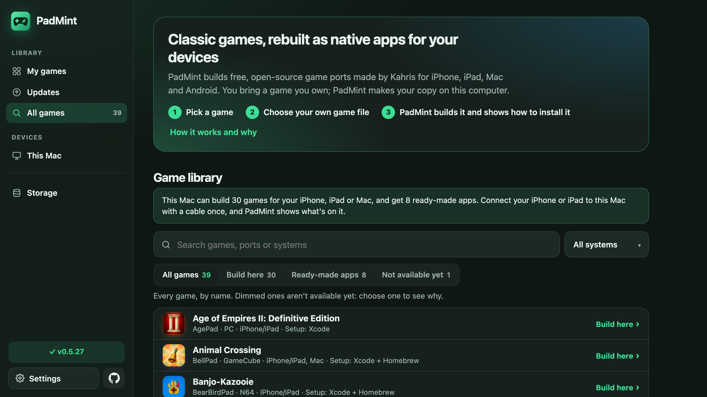

<p align="center">
  
</p>

<h1 align="center">PadMint</h1>

<p align="center">
  <strong>Make your own copy of a game from your own game file.</strong><br>
  Choose a game, see where it builds, and follow the steps to build and install it.
</p>

<p align="center">
  <a href="https://github.com/chrissotraidis/padmint/releases/latest"></a>
  <a href="https://github.com/chrissotraidis/padmint/actions/workflows/windows-package-check.yml"></a>
  
  
  <a href="https://discord.gg/xwHfUD2bxW"></a>
</p>

## What PadMint can do on your computer

**You can build games from Windows today.** Some builds run on your computer;
others use **GitHub Cloud Build**, which runs a temporary macOS machine in
GitHub's cloud. You do not need to own a Mac for that route.

| Your computer | What PadMint can make |
|---|---|
| **Mac with Apple Silicon** (M1 or newer) | All 30 games it offers to build for iPhone and iPad; 12 also have Mac builds. Check each game's setup and experimental status. |
| **Windows or Linux** | **Build here:** KartPad (Mario Kart Wii), for Android or iPhone/iPad, experimental. **GitHub Cloud Build:** 15 more games can build separate iPhone/iPad copies on a temporary macOS machine hosted by GitHub. **Apple Silicon Mac:** the other games need Apple Silicon and Xcode. PadMint also lists 8 ready-made iPad apps (PC classics such as Diablo). |
| **Intel Mac** | Builds KartPad for Android or iPhone/iPad, experimental. Mac app copies and the other iPhone/iPad builds require an Apple Silicon Mac. |
| **An Android phone, no computer** | Experimental: Mario Kart Wii's game data, through Termux. |

PadMint also lists **8 ready-made iPad apps** to install with Sideloadly on
Windows or Mac; each page explains any game files you need to add. Building an
iPhone/iPad app from Windows does not create a Windows desktop version. To play
on a Windows PC, BlueWake has a
[separate ready-made download](https://github.com/chrissotraidis/bluewake/releases/latest).

**More local Windows builds are in active development.**
PadMint 0.5.15 shipped the shared Windows build tools, cache/retry handling and
cancellation fixes; 0.5.16 makes the build locations explicit. Additional local
game builds stay unavailable until each game's matching app, recipe and device
checks are ready. Follow [Building games on Windows](docs/WINDOWS.md), the
[progress by game](docs/COMPATIBILITY.md#status-by-game), and the
[roadmap](https://github.com/chrissotraidis/padmint/blob/main/docs/ROADMAP.md).
An experimental recipe or completed build alone does not establish that a game
plays correctly on every device.

## Quick start

**1. Download PadMint** for the computer you're using. It's free and has no games in it.

| Your computer | Download | Open it |
|---|---|---|
| **Mac** | **[⬇ PadMint for Mac](https://github.com/chrissotraidis/padmint/releases/latest/download/PadMint-macos.zip)** | Double-click the ZIP, open the new folder and double-click **PadMint.command**. The first time, macOS says Apple could not verify it: choose **Done**, then **System Settings → Privacy & Security → Open Anyway**. If macOS offers to install *command line developer tools*, click **Install**, wait, then double-click PadMint.command again. |
| **Windows** 10 or 11 | **[⬇ PadMint for Windows](https://github.com/chrissotraidis/padmint/releases/latest/download/PadMint-windows.zip)** | Right-click the ZIP, choose **Extract All**, open the new folder and double-click **PadMint**. If Windows says it protected your PC, choose **More info**, then **Run anyway**. Python is included. |
| **Linux** | **[⬇ PadMint for Linux](https://github.com/chrissotraidis/padmint/releases/latest/download/PadMint-linux.zip)** | Unzip it and run `sh padmint.sh` in the folder. Needs Python 3.9+ and Git. |

Use these links, not GitHub's green **Code** button: that one downloads PadMint's
source code, which is for developers.

**Where it lives:** PadMint has no installer. It is the folder you unzipped,
plus a hidden `.padmint` folder in your home folder where it keeps the game
sources, tools and builds it downloads. **Storage** in PadMint's sidebar shows
that folder and frees space; [Removing PadMint](#removing-padmint) deletes both.

**Updating PadMint?** On a Mac or Linux, click the version button at the bottom
of PadMint's sidebar when it says an update is out; PadMint installs it and
restarts. On Windows, close PadMint's window, download the ZIP again, extract it
and open the launcher in the **new folder**: the game list comes with that
folder, so refreshing the browser or opening the old folder keeps the old list.
Your disc images, builds and saves stay where they are.

**2. Keep the small window open.** It is PadMint working. Your web browser opens
the PadMint page; if it doesn't, open the `http://127.0.0.1…` address the
window shows. The page comes from your own computer, not a website.

**3. Choose your game and follow the page.** It tells you exactly what to
install for a local build, with a **Check again** button, or links to the steps
for a GitHub Cloud Build. You fork the repository and run its workflow in your browser;
GitHub's hosted macOS build machine compiles the app. The page also shows how to put the result on your
phone or tablet. It speaks English, Spanish and Portuguese
(**Settings**, at the bottom of the sidebar). Close the small window when you are done.

**4. Your games, on every device.** On a Mac with Xcode, PadMint looks at the
iPhones and iPads you've connected to this Mac once and lists the Pad games on
each, with their versions. **My games** and **Updates** show what's behind.
Without Xcode, or on Windows and Linux, it lists the copies it built here.

## Your first game

On a Mac, each game says how much setup it needs. Start with an easy one:

| Tag on the page | Games | What you need |
|---|---|---|
| **Easiest** | KartPad for Android (Mario Kart Wii) | Any Windows, Mac or Linux computer, an Android phone, and the **European** Mario Kart Wii disc. Install the ready-to-play app; PadMint makes its game data. |
| **Needs Xcode** | BlueWake (Wind Waker, US disc), SunPad (Super Mario Sunshine, US disc), KartPad for Mac, and KartPad for iPhone when you build on a Mac (European disc), AgePad (Age of Empires II from Steam) | A Mac with Apple Silicon (M1 or newer) and [Xcode](https://apps.apple.com/app/xcode/id497799835), free from the App Store. PadMint downloads everything else. |
| **Needs Xcode + Homebrew** | Most other games | The same, plus one Homebrew line that the page shows you, with a Copy button. |

**KartPad for iPhone and iPad doesn't need a Mac.** On Windows or Linux,
PadMint builds it with its own compiler, so there's no Xcode to install. That
route is experimental: it's checked less often than building on a Mac.

Your game file must be the version the page names, for example **Only the US
(North American) version works**. PadMint checks it as soon as you pick it.

<p align="center">
  
</p>

> **Other ready-to-play downloads:**
> **KartPad for Android** from the [latest KartPad](https://github.com/chrissotraidis/kartpad/releases/latest)
> (the app has the game code; you add your own game data, which PadMint can make from your disc), and
> **BlueWake for Windows** from [BlueWake's releases](https://github.com/chrissotraidis/bluewake/releases/latest).
> KartPad for iPhone and iPad uses PadMint to build a personal copy from your own game file.

## Why PadMint exists

PadMint helps you make a personal copy from **your own game files**. Games that
translate your disc or ROM during a build keep that work on your computer.
The supported GitHub routes build the app first; you add your files on your
device afterward. The library shows what each game needs and where it stands,
even games it can't build yet.

Your game file never leaves your computer and PadMint uploads nothing. The page
it opens is served by your own computer, and before anything starts it lists
every download, where it comes from, its size and the free space needed.

**What's in the folder you unzipped:**

```
PadMint-v…/
├── PadMint          double-click this (PadMint.command on Mac, padmint.sh on Linux)
├── Start here.txt   these steps, in English, Spanish and Portuguese
└── app/             PadMint itself: you don't need to open it
```

The `app` folder holds PadMint's code, the game list and these guides, and on
Windows a copy of Python. It is plain, readable source, so anyone can check what
PadMint does.

<details>
<summary><strong>Why a ZIP, and not an installer or a .dmg?</strong></summary>

An installer only helps if it is signed: Windows and macOS warn about unsigned
installers exactly as they warn about these launchers, and signing needs a paid
certificate for each system. One ZIP with a double-click launcher works the same
way on Windows, Mac and Linux, and every release is rebuilt from this repository
on separate computers and compared byte for byte before it is published. Signed
apps are a later step if players need them.

</details>


## What you can make, and where

What PadMint can do depends on the computer it runs on. The top of the game
library says it in one line, and every game is listed either way, so you can
see what exists.

| Your computer | What PadMint does there |
|---|---|
| **Mac with Apple Silicon** (M1 or newer) and [Xcode](https://apps.apple.com/app/xcode/id497799835) | Builds the catalog's 29 buildable games for iPhone and iPad. Mac targets are Animal Crossing, Crash Team Racing, F-Zero X, Halo, Jak and Daxter, Mario Kart Wii, Pokémon Snap, Pokémon Stadium, Super Mario Sunshine, Super Smash Bros., Melee and Tribes 2. Shows which games are on the iPhones and iPads you've connected to the Mac once, and which need an update. |
| **Windows or Linux** | **Build here:** KartPad's Android game data or experimental iPhone/iPad app. **GitHub Cloud Build:** [15 more iPhone/iPad games](#github-cloud-build-no-mac-needed). [HaloPad's Xbox edition has its own GitHub workflow](https://github.com/chrissotraidis/projectreach#on-windows-linux-or-any-computer). Other games explain their Apple Silicon Mac requirement or paused status. Ready-made apps can be installed from Windows or Mac; Linux installation is not validated. |
| **Intel Mac** | KartPad Android and iPhone/iPad builds, experimental. Mac apps and the other iPhone/iPad builds require Apple Silicon. |

The library sorts games into groups. Use **All games** to see them all, or the
tabs to narrow the list:

| Group | What it means |
|---|---|
| **Build here** | PadMint compiles on this computer. Today on Windows and Linux this is KartPad only, experimental; its output is an Android pack or iPhone/iPad `.ipa`. The page says when it needs your game file. |
| **Ready-made apps** | Download and install the app with your own Apple ID; its page explains any game files you need to add. |
| **GitHub Cloud Build** | GitHub runs a temporary macOS build machine for your PadMint fork and compiles an iPhone/iPad `.ipa`. PadMint on Windows or Linux only starts the workflow. This is not a local Windows build. |
| **Other routes** | Games that need an Apple Silicon Mac with Xcode, use their project's own separate route, have a separate Windows download such as BlueWake, or are paused. Each card states which one applies. |
| **Not on your devices** | Once you have games: the ones that aren't on any of your devices yet. |

Each game says where it is: **On iPad · iPhone**, an update such as
**v0.2.0 → v0.2.2**, or **Not installed**. For each game's exact versions,
hosts and known problems, see [build compatibility](docs/COMPATIBILITY.md).

## Using PadMint

**The sidebar.** **My games** lists every game PadMint found on your devices and
the copies it built, with the version on each device. **Updates** shows the ones
behind the latest release. **All games** is the full library. Under **Devices**,
each iPhone, iPad, this Mac and Android has its own list. **Storage** shows the
space PadMint uses and frees what it no longer needs. The version button at the
bottom says when PadMint itself has an update, and **Settings** next to it holds
the language, your devices, where copies are saved and help. Click a section heading in My
games, such as **Updates available**, to fold it. To find a game, just start
typing: PadMint jumps to the library's search, which matches game, port and
system names.

**A game's page** goes from top to bottom:

1. **Your copies:** where you have it, and which device is behind.
2. **Your own game file:** click **Choose file…** and pick your disc image or
   ROM (the file window may open behind your browser). The page says which
   version works, for example **Only the European (PAL) version works**, lists
   matching files already in your Downloads folder and checks the file straight
   away. Some games ask for the file inside the app instead; the page says so.
3. **Where will you play?** The device you'll play on, whichever computer you're
   using. **This Mac** appears for games with a Mac version, on an Apple Silicon
   Mac.
4. **What PadMint will do on this computer** lists everything before it starts.
   **Before you start (one time only)** marks each program **found** or **not found**
   and says how to get it: Xcode from the App Store, and one Homebrew line with a
   **Copy** button for everything else. Install what's missing, click **Check again**,
   then **Make my copy** (or **Update to v…** when you have an older one). If the
   button is gray, the line under it says why. **After the build: how to install
   and play** shows the device steps in advance.

The page then shows a checklist: finding the latest release, downloading the
source, each tool with its progress, the build with its current step, and saving
your copy. Keep the computer plugged in; PadMint keeps it awake while it builds.
The first build of a game can take from a few minutes to a few hours. Finished
work is kept, so **Cancel** and later builds are safe and quicker.

When it finishes, the page shows **Your copy is ready**, the file it saved in
your Downloads folder and **What to do next**. If it stops, it says why: open
**Technical log** and use **Copy log for a bug report** when asking for help.

<a id="no-mac-build-on-githubs-mac"></a>
## GitHub Cloud Build (no Mac needed)

**GitHub Cloud Build** means GitHub runs a temporary macOS build machine for
your free PadMint fork. PadMint on Windows or Linux starts the workflow in your
browser; it does not compile these games locally and does not make a Windows
desktop copy.

**Use this route from Windows, Linux or an Intel Mac.** You run the workflow in
your browser; compilation happens on GitHub's hosted macOS build machine. The result is an iPhone/iPad
app, not a Windows desktop game. Your own game files are not uploaded.

These games take your own game file inside the app, after installing, so the build
itself needs nothing of yours: BallPad, BarrelPad, BellPad, BrawlerPad, CTRPad,
F0X, GalaxyPad, HarkinianPad, MaskPad, OpenRCT2 Touch, PaperPad,
SpaghettiPad, StarshipPad, TribesPad and UTP. GitHub lends a Mac for free to
public repositories, and it can make your iPhone and iPad copy from Windows,
Linux or any computer with a web browser:

1. Sign in to [GitHub](https://github.com) (a free account is enough) and open
   [PadMint's page](https://github.com/chrissotraidis/padmint). Press **Fork**, then
   **Create fork**.
2. In your fork, open **Actions**. If GitHub asks, press **I understand my
   workflows, go ahead and enable them**.
3. Choose **Build a game for iPhone and iPad**, press **Run workflow**, pick the
   game and press the green **Run workflow**. It takes a few minutes for small
   games and about 40 minutes for the largest.
4. Open the finished run and download the file under **Artifacts**. Unzip it to
   get the `.ipa`. GitHub keeps it for one day.
5. Install the `.ipa` with Sideloadly ([Installing what you made](#installing-what-you-made)),
   then open the game and add your own game file as its page explains.

To update a game later, press **Sync fork** in your fork, run the workflow again
and install the new `.ipa` over the old app with the same Apple ID, so your saves
stay. The copy holds game code made for you: keep it to yourself.

**HaloPad's Xbox edition uses its own workflow:** fork or sync
[HaloPad](https://github.com/chrissotraidis/projectreach#on-windows-linux-or-any-computer),
then choose **Actions → Build HaloPad (Xbox edition) → Run workflow** there.
HaloPad is not one of the 16 choices in PadMint's workflow. It also provides a
Mac app for playing on a supported Mac; PC Custom Edition builds still need
your own Apple Silicon Mac.

**Melee PC has a private-repository route:** [follow its GitHub build guide](https://github.com/chrissotraidis/melee-pc-padmint#build-on-github-without-a-mac).
Import PadMint into a new **private** repository instead of making a public fork,
then select `melee-pc` in the same workflow. The workflow refuses to upload this
personal IPA from a public repository. Private Actions usage counts against your
account's allowance; check your GitHub Actions budget before starting. No disc,
save, Apple ID or signing certificate is needed during the build.

## Installing what you made

**iPhone or iPad:** PadMint saves `<Game>-v…-ios-personal.ipa`, the complete app
with your game inside. To put it on your device with [Sideloadly](https://sideloadly.io)
(free, Mac or Windows) and your own Apple ID:

1. Install Sideloadly and open it.
2. Connect your iPhone or iPad with a cable. Unlock it and tap **Trust** if it asks.
3. Drag the `.ipa` into Sideloadly, type your Apple ID email and click **Start**.
   Sideloadly asks for your Apple ID password to sign the app with Apple.
4. On the device: **Settings → General → VPN & Device Management**, tap your
   Apple ID, then **Trust**.
5. If it says Developer Mode is required: **Settings → Privacy & Security →
   Developer Mode → On**, then restart when asked.

With a free Apple ID the app opens for 7 days; drag the same file into Sideloadly
again to keep playing. To update, build the new version with PadMint and install
it the same way with the same Apple ID; your saves stay. [AltStore](https://altstore.io)
and [SideStore](https://sidestore.io) work too. HaloPad needs a paid Apple
developer account; its guide explains why.

**Mac (CTRPad):** PadMint saves `<Game>-v…-macos-personal.zip`. Open it, move the
app to Applications and open it; the game asks for your own game file. To update,
build the new version and replace the old app; your saves stay.

The `…-ios-unsigned.ipa` on a game's release page is PadMint's starting point:
it has no game code, so it can't play by itself.

**Android (KartPad):** PadMint makes a `KartPad game data` folder. Install
KartPad's APK from the [latest KartPad](https://github.com/chrissotraidis/kartpad/releases/latest),
copy the folder to the phone, then in KartPad tap **Import Game** → **Import from
Extracted Game Data Folder…**. [KartPad's guide](https://github.com/chrissotraidis/kartpad#get-kartpad)
has every step.

Everything PadMint makes is made from your copy of the game: keep it to
yourself and don't share it.

## Android phone only (experimental)

This route makes KartPad's `KartPad game data` folder on a 64-bit Android
phone, without a computer. Most players should install
[KartPad's ready-to-play APK](https://github.com/chrissotraidis/kartpad/releases/latest)
and use a computer for the folder instead. It needs about 8 GB of memory, 25 GB
free, Wi-Fi for about 6 GB of downloads, and an hour or more, and has only been
tried on an emulator.

1. Install **Termux** from [F-Droid](https://f-droid.org/packages/com.termux/)
   or its [GitHub releases](https://github.com/termux/termux-app/releases)
   (the `arm64-v8a` APK), not Google Play. Open it once. If Android blocks the
   installation, don't bypass the warning: use a computer instead.
2. Copy your disc image into the phone's **Download** folder.
3. In Termux, paste this line and press Enter:

   ```
   curl -fsSL https://raw.githubusercontent.com/chrissotraidis/padmint/main/launchers/padmint-android.sh | sh
   ```

   It checks the phone first and says, before downloading anything, if it isn't
   64-bit or lacks memory or space. If setup stops, run the same line again;
   finished steps are kept.
4. Tap **Allow** if Android asks about your files. PadMint opens in the phone's
   browser: choose **KartPad**, tap your disc image and tap **Make my copy**.
   Keep Termux open, with the screen on, until the page says your copy is ready.

Next time, type `padmint` in Termux. If Android stops the build ("Process
completed (signal 9)"), turn on **Settings → System → Developer options →
Disable child process restrictions** and run `padmint` again. To free the space
afterwards, see [Removing PadMint](#removing-padmint).

## Removing PadMint

PadMint doesn't install itself anywhere. It is the folder you unzipped, plus
one folder of its own, `.padmint` in your home folder, which keeps the game
sources, tools and builds it downloaded. That folder can take tens of GB.
Each game version gets its own folder there. After a newer version builds,
PadMint deletes the build files the older versions left behind and says how
much space it freed.

1. If a build is running, press **Cancel** on the PadMint page or wait for it to
   finish. Then close PadMint's small window (on a Mac, the Terminal window).
2. Move the PadMint folder you unzipped to the Trash (Recycle Bin on Windows).
3. Delete the `.padmint` folder:
   - **Mac:** open **Terminal** (Applications → Utilities), paste this line and
     press Return:

     ```
     rm -rf ~/.padmint ~/.padforge
     ```

     Paste it exactly as shown: it deletes those two folders straight away,
     without the Trash, and shows nothing when it has worked. `.padforge` is
     PadMint's old folder name; it's fine if you don't have one.
     To use Finder instead, choose **Go → Home**, press **Command-Shift-.**
     (period) to show hidden folders, and move `.padmint` (and `.padforge`, if
     it's there) to the Trash.
   - **Windows:** type `%USERPROFILE%` in File Explorer's address bar, press
     Enter and delete `.padmint`.
   - **Linux:** run the same line as on a Mac.
   - **Android phone:** in Termux, run
     `proot-distro remove padmint; rm -f $PREFIX/bin/padmint $PREFIX/etc/proot-distro/padmint.sh`.
     If you installed Termux only for PadMint, uninstalling Termux removes all of it.
4. If you moved anything to the Trash or Recycle Bin, empty it to get the space back.

Removing PadMint leaves what it made alone. Your copies in Downloads and the
games installed on your iPhone, iPad or Android phone keep working, and so do
their saves. Your own game file also stays where you keep it. Don't delete a
game's app unless you mean to: that deletes its saves too. If you use PadMint
again later, it downloads its tools and game sources again.

**On a Mac, you may also have installed these for PadMint.** They are separate
programs that other apps use too, so removing PadMint leaves them in place. If
you're not sure whether something else needs them, keep them.

- **Apple's command line tools**, the download from `xcode-select --install` or
  the box macOS showed the first time you opened PadMint. To remove them, paste
  `sudo rm -rf /Library/Developer/CommandLineTools` into Terminal exactly as
  shown and type your Mac password when asked; nothing appears while you type it
  ([Apple's steps](https://developer.apple.com/documentation/xcode/installing-the-command-line-tools#Uninstall-the-Command-Line-Tools-for-Xcode-package)).
  Without Xcode, Git and `python3` then stop working in Terminal until you run
  `xcode-select --install` again.
- **Homebrew**, if a game asked for its `brew install` line:
  [Homebrew's uninstall steps](https://docs.brew.sh/FAQ#how-do-i-uninstall-homebrew)
  remove every program installed with Homebrew, not only the ones PadMint's
  games needed.
- **Xcode:** move it from Applications to the Trash. You can also delete
  `~/Library/Developer/Xcode/DerivedData`, where Xcode keeps build files.
- `~/Library/Caches/com.apple.python` holds a few MB that Apple's Python saved
  while running PadMint. It is only a cache: delete it or leave it.

## Questions

Click a question to see the answer.

<details>
<summary><strong>My game isn't in the list, or it's dimmed.</strong></summary>

Choose it anyway: the page names the actual route. **Build here** means PadMint
compiles on your PC. **GitHub Cloud Build** means a temporary macOS machine
hosted by GitHub compiles it. **Apple Silicon Mac** means it needs your own Apple Silicon
Mac with Xcode, unless the project documents another route. **Not available
yet** means there is nothing to build or download through PadMint yet.

</details>
<details>
<summary><strong>Can I play KartPad on my Mac?</strong></summary>

Yes, with the latest PadMint (**0.5.18**), on a Mac with Apple Silicon (M1 or newer)
and Xcode: choose **Mario Kart Wii**, then **This Mac** under **Where will you
play?** PadMint builds KartPad from your disc and saves the app in your Downloads
folder. The first build needs about 12 GB free. On an Intel Mac, PadMint builds KartPad for iPhone and iPad
(experimental), but the Mac app itself needs Apple Silicon.

**Only seeing iPhone/iPad and Android?** Download the latest
[PadMint for Mac](https://github.com/chrissotraidis/padmint/releases/latest/download/PadMint-macos.zip)
and open `PadMint.command` from the newly extracted folder. Check **Apple menu
→ About This Mac**: **Chip: Apple M…** is supported; an Intel processor isn't
supported for playing KartPad on Mac.

PadMint **0.5.3 and newer** automatically restarts natively on Apple Silicon when launched
through Rosetta. This fixes the missing **This Mac** option that could occur in
0.5.2. On Intel Macs, PadMint explains why the Mac copy is unavailable and keeps
the supported iPhone/iPad and Android choices. Keep your disc images, builds,
caches and saves; none need deleting to restore the Mac option.

</details>
<details>
<summary><strong>Can I build iPhone apps on Windows or Linux?</strong></summary>

On your own computer, only KartPad today, and that is experimental. Fifteen
games that take your game file inside the app can be made on
[GitHub Cloud Build](#github-cloud-build-no-mac-needed) instead, and HaloPad's Xbox
edition has [its own GitHub route](https://github.com/chrissotraidis/projectreach#on-windows-linux-or-any-computer).
The games that read your disc or ROM while building (BlueWake, SunPad, MeleePad,
the N64 recompilations, Jak and Daxter) need a Mac with Apple Silicon and Xcode
for now, unless their project documents another route. PadMint will add each one
to **Build here** on Windows only after its release contains a Windows recipe,
matching app or shell, and physical-device check. See the current roster in
[Building games on Windows](docs/WINDOWS.md). None of these is a Windows desktop build.

That work is active: PadMint 0.5.15 shipped the shared Windows build foundation.
Each additional local route still needs its own matching release, recipe and
device checks. See [progress by game](docs/COMPATIBILITY.md#status-by-game).

</details>
<details>
<summary><strong>The window closed, or nothing seems to happen.</strong></summary>

PadMint opens a page in your web browser. If no browser opened, the PadMint
window shows a link starting with `http://127.0.0.1`: open it. The first time,
it can take a minute before the page opens or a build gets past **Starting…**.

</details>
<details>
<summary><strong>It says my file is the wrong version, region or size.</strong></summary>

Each game needs one exact version of the game, named on its card and in its
README (for example KartPad needs the European disc, RMCP01). Use an untouched
1:1 dump: trimmed, patched or half-size files are refused on purpose.

</details>
<details>
<summary><strong>It says my file is stored only in iCloud (Mac).</strong></summary>

In Finder, right-click the file, choose **Download Now**, wait, then choose it
again.

</details>
<details>
<summary><strong>The app I made doesn't open on iOS or iPadOS 27.</strong></summary>

Build it again with PadMint and install it over the old copy; your saves stay.
Apps built with Xcode 27 have to use the newer app startup Apple requires, and
every game's latest release has it since 4 October, so a copy built before then
may not open on iOS 27. If a new copy still doesn't open, report it on the game's
issue page. The [compatibility page](docs/COMPATIBILITY.md#recorded-mac-builds-4-october)
has the details.

</details>
<details>
<summary><strong>Windows or macOS warns me about PadMint.</strong></summary>

Expected for a free tool without a paid certificate. Windows: **More info →
Run anyway**. Mac: **System Settings → Privacy & Security → Open Anyway**.
Only download PadMint from its
[releases page](https://github.com/chrissotraidis/padmint/releases/latest).

</details>
<details>
<summary><strong>It says a download was blocked, or it stops early.</strong></summary>

PadMint names the server it couldn't reach. Check your internet connection and
the device's date and time, then run PadMint again; finished downloads are kept.
Keep certificate checks and security software turned on.

</details>
<details>
<summary><strong>Linux asks me to install something (libxml2, Git).</strong></summary>

Run the command PadMint shows, for example `sudo apt install libxml2`, then
start PadMint again.

</details>
<details>
<summary><strong>Can someone send me their IPA or game data?</strong></summary>

No. It's made from their copy of the game, so sharing it means sharing the
game. Please don't ask for one or post yours.

</details>
<details>
<summary><strong>What was PadForge?</strong></summary>

PadMint's old name. PadMint moves your old PadForge folder over and keeps the
tools you already downloaded.

</details>
<details>
<summary><strong>Still stuck?</strong></summary>

Ask in the [Discord](https://discord.gg/xwHfUD2bxW) or open a
[PadMint issue](https://github.com/chrissotraidis/padmint/issues) for setup,
download or build problems. Include the game, your computer (Windows, Mac or
Linux), the device you're building for and the copied log. Keep game files,
keys and personal builds out of it. For a game that builds but has problems
while playing, use that game's issue page.

</details>

---

*The rest of this page is for developers and game maintainers.*

## All commands

Python 3.9 or newer; no packages needed. On Windows PadMint downloads Git
itself; on a Mac or Linux it uses the system's Git (`xcode-select --install`,
or your package manager, for example `sudo apt install git`). From this
repository:

```sh
python3 -m padmint list                      # supported games and platforms
python3 -m padmint make kartpad android --disc 'your disc.wbfs'   # the one-step path
python3 -m padmint                           # the PadMint page in your browser (start: terminal)
python3 -m padmint doctor kartpad            # check this computer (installs nothing)
python3 -m padmint tools kartpad --target android --repo /path/to/kartpad   # get pinned tools
python3 -m padmint get kartpad /path/to/kartpad   # download a game's source
python3 -m padmint doctor bluewake --repo /path/to/bluewake
python3 -m padmint audit path/to/file-or-folder   # release gate
python3 -m padmint history --repo /path/to/game-repo   # recorded builds
python3 -m padmint check-manifest /path/to/game-repo
python3 -m padmint plan bluewake --repo /path/to/bluewake \
  --revision FULL_REVIEWED_COMMIT --disc '/path/to/your disc.iso'
```

`plan` validates paths, checkout state and platform support and prints the
exact backend command without building. Change `plan` to `build` to run it.
Use `--target` to choose a platform the game declares (default `ios`),
`--source-only`/`--no-mods` where the game supports them, and `--jobs 1-8`.

Builds run on the platforms each game marks *verified* or *experimental*;
`list` shows the rest as *planned*. KartPad's Android game data builds on
Windows, Linux and macOS (x64 and ARM64) and, experimentally, on an Android
phone. iPhone/iPad builds use an Apple Silicon Mac, GitHub Cloud Build, or (for
KartPad) a local experimental build on Windows, Linux or an Intel Mac. See
[Building games on Windows](docs/WINDOWS.md) and [STATUS.md](STATUS.md) for the
current routes and verified work.

What PadMint builds on which computer, and what comes next, is tracked in
[the roadmap](https://github.com/chrissotraidis/padmint/blob/main/docs/ROADMAP.md).

The [catalog](catalog/) lists every public game: the ones PadMint builds, the
apps with nothing to build (`download`) and the ones not available yet
(`later`). [COMPATIBILITY](docs/COMPATIBILITY.md) has each game's status and
next step.

## How games plug in

Each game repository declares a `padmint.json` manifest (schema in
[padmint/manifest.py](padmint/manifest.py)): accepted inputs, platforms and
their status, the backend command, stages, requirements and publication
policy. PadMint's [catalog](catalog/) pins each supported game and carries an
interim manifest for repositories that do not have one yet. Game-specific
translation, patches and packaging stay in the game repository.
See [Adding a game](docs/ADDING_A_GAME.md) for a complete example.

## What a build does and does not do

This describes `plan`/`build` on a checkout you provide (`make` and the
guided start do the downloading for you).

- Keep the game checkout clean at a commit you have reviewed. `plan` and
  `build` do not download repositories or install tools; follow `doctor`'s
  suggestions or use `tools` and `get`.
- Builds, logs and records stay under the game's ignored `build/padmint/`.
  One PadMint build runs per checkout; Ctrl-C cancels and keeps finished work.
- Every personal output is checked for structure and provenance, then run
  through the release gate. The record labels it *personal build, not
  publishable* regardless of the gate result.
- Nothing is installed on a device or uploaded. A personal IPA still needs
  your own signing (AltStore, SideStore, Sideloadly or Xcode).

## The release gate

`padmint audit` scans files, folders and ZIP-based packages for console keys,
address-named translated game functions, embedded original program sections
and provenance declaring translated game code. It fails closed on archives it
cannot inspect. Keys are identified by a short prefix and a SHA-256 hash; this
repository contains no keys. A PASS is a heuristic result, not copyright or
licensing clearance.

Game inputs, generated game code, saves, keys, personal builds and optimization
profiles never belong in this repository.

## Tests

```sh
python3 -m unittest discover -s tests -v
```

## Legal

PadMint is an unofficial, fan-made tool. It is not affiliated with, endorsed by,
or sponsored by Nintendo or any other game publisher. Game titles named here are
trademarks of their respective owners, including Nintendo. This repository
contains no game data, ROMs, disc images, or extracted assets. To use it, you
need your own legally obtained copy of each game, and PadMint builds it on your
own machine. Please don't share game files or builds made from them.
