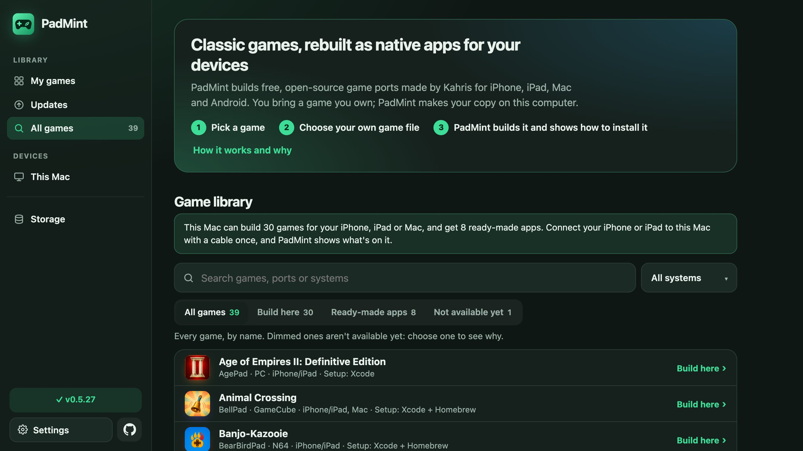

<p align="center">
  
</p>

<h1 align="center">PadMint</h1>

<p align="center">
  <strong>Build your own iPhone, iPad and Mac copy of a game from your own game file.</strong>
</p>

<p align="center">
  <a href="https://github.com/chrissotraidis/padmint/releases/latest"></a>
  
  
  <a href="https://discord.gg/xwHfUD2bxW"></a>
</p>

PadMint is a free app that builds the Pad game ports (KartPad, BlueWake, HaloPad
and 30 more) for your iPhone, iPad, Mac or Android phone. You pick a game, give
it your own disc image or ROM when the game needs one, and PadMint downloads the
source and free tools, builds your copy and tells you how to install it.

PadMint contains no games, and your game file never leaves your computer.

<p align="center">
  
</p>

## Quick start

**1. Download PadMint** for the computer you're using.

| Your computer | Download | Open it |
|---|---|---|
| **Mac** | **[⬇ PadMint for Mac](https://github.com/chrissotraidis/padmint/releases/latest/download/PadMint-macos.zip)** | Double-click the ZIP, then **PadMint.command** in the new folder. |
| **Windows** 10 or 11 | **[⬇ PadMint for Windows](https://github.com/chrissotraidis/padmint/releases/latest/download/PadMint-windows.zip)** | Right-click the ZIP, **Extract All**, then double-click **PadMint** in the new folder. Python is included. |
| **Linux** | **[⬇ PadMint for Linux](https://github.com/chrissotraidis/padmint/releases/latest/download/PadMint-linux.zip)** | Unzip it and run `sh padmint.sh`. Needs Python 3.9+ and Git. |

The first time, your computer warns that PadMint isn't from an identified
developer, because it has no paid certificate. On a Mac choose **Done**, then
**System Settings → Privacy & Security → Open Anyway** (and click **Install** if
macOS offers command line developer tools). On Windows choose **More info → Run
anyway**. Use the links above, not GitHub's green **Code** button, which
downloads the source code.

**2. Keep the small window open.** That is PadMint running. Your browser opens
the PadMint page, served by your own computer. If it doesn't open, use the
`http://127.0.0.1…` address shown in the window.

**3. Choose a game and follow its page.** The page names the exact game version
you need, lists anything to install first with a **Check again** button, and
shows every download and its size before anything starts. Then press **Make my
copy**. A first build takes from a few minutes to a few hours.

**4. Install it** on your iPhone or iPad with Sideloadly
([steps below](#install-on-iphone-or-ipad)). The page also explains Mac and
Android installs.

**Updating PadMint:** on a Mac or Linux, click the version button at the bottom
of the sidebar when it offers an update. On Windows, download the ZIP again,
extract it and open PadMint from the **new folder**. The game list ships inside
that folder, so refreshing the browser or opening the old folder keeps the old
list. Your game files, builds and saves stay where they are.

## What your computer can build

Every game is built one of three ways, and each game's page shows only the ways
that work on the computer you're using:

- **Build on this computer:** PadMint builds the app on your computer.
- **Build on GitHub's Mac:** you start a free build on GitHub from your browser,
  and GitHub compiles the app on a temporary Mac. You add your game file inside
  the app afterwards, so nothing of yours is uploaded.
- **Download the app:** eight ready-made apps for PC classics. You add your own
  game files inside the app.

| Your computer | Builds here | Builds on GitHub's Mac |
|---|---|---|
| **Mac with Apple Silicon** (M1 or newer) | All 31 games for iPhone/iPad, 12 of them also as Mac apps | 17 games, under **Other ways to build** |
| **Windows PC** | 7 games, experimental | 17 games |
| **Linux** | KartPad, experimental | 17 games |
| **Intel Mac** | KartPad, experimental | 17 games |
| **Android phone**, no computer | KartPad's game data, [experimental](docs/GUIDE.md#android-phone-only-experimental) | — |
| **Chromebook** (untested) | With Linux turned on, the same as Linux | 17 games |

The ready-made apps install from any Windows PC or Mac. Installing on an iPhone
or iPad needs Sideloadly on a Windows PC or Mac, so Linux and Chromebook players
copy the app to one of those first.

PadMint doesn't make Windows or Linux desktop games. For those, see
[BlueWake's downloads](https://github.com/chrissotraidis/bluewake/releases/latest).
[KartPad for Android](https://github.com/chrissotraidis/kartpad/releases/latest)
is also a ready-to-play download; PadMint makes its game data from your disc.

<details>
<summary><strong>Every game and where it builds</strong></summary>

✓ means PadMint builds it there. *Exp.* means experimental: it builds, but a
copy built there hasn't yet been installed and played on a device. The GitHub
column works from any computer with a browser.

| Port | Game | Apple Silicon Mac | Windows PC | GitHub's Mac |
|---|---|---|---|---|
| AgePad | Age of Empires II: DE (Steam) | ✓ ¹ | — | — |
| AnnePad | Pokémon Stadium (N64) | ✓ + Mac app | — | — |
| BallPad | Super Mario Strikers (GameCube) | ✓ | — | ✓ |
| BananaPad | Donkey Kong 64 (N64) | ✓ | Exp. | — |
| BarrelPad | Diddy Kong Racing (N64) | ✓ | — | ✓ |
| BearBirdPad | Banjo-Kazooie (N64) | ✓ | Exp. | — |
| BellPad | Animal Crossing (GameCube) | ✓ + Mac app | — | ✓ |
| BlueWake | The Legend of Zelda: The Wind Waker (GameCube) | ✓ | — | — |
| BrawlerPad | Super Smash Bros. (N64) | ✓ + Mac app | — | ✓ |
| CTRPad | Crash Team Racing (PlayStation) | ✓ + Mac app | — | ✓ |
| DarkPad | Perfect Dark (N64) | ✓ | — | Exp. ² |
| DinoPad | Dinosaur Planet (N64 prototype) | ✓ | Exp. | — |
| F0X | F-Zero X (N64) | ✓ + Mac app | — | ✓ |
| GalaxyPad | Super Mario Galaxy (Wii) | ✓ | — | ✓ |
| GoldenPad | GoldenEye 007 (N64) | ✓ | Exp. | — |
| HaloPad | Halo: Combat Evolved (Xbox) or Custom Edition (PC) | ✓ + Mac app | — | Xbox edition ³ |
| HarkinianPad | The Legend of Zelda: Ocarina of Time (N64) | ✓ | — | ✓ |
| KartPad | Mario Kart Wii (Wii) | ✓ + Mac app | Exp., also Android data ⁴ | — |
| MaskPad | The Legend of Zelda: Majora's Mask (N64) | ✓ | — | ✓ |
| MeleePad | Super Smash Bros. Melee (GameCube) | ✓ + Mac app | Exp. | — |
| NightPad | 007: Nightfire (Xbox) | ✓ | — | — |
| OpenRCT2 Touch | RollerCoaster Tycoon 2 (PC) | ✓ | — | ✓ |
| Ottsel | Jak and Daxter: The Precursor Legacy (PS2) | ✓ + Mac app | — | — |
| PaperPad | Paper Mario (N64) | ✓ | — | ✓ |
| SnapPad | Pokémon Snap (N64) | ✓ + Mac app | — | — |
| SpaghettiPad | Mario Kart 64 (N64) | ✓ | — | ✓ |
| SquirrelPad | Conker's Bad Fur Day (N64) | ✓ | Exp. | — |
| StarshipPad | Star Fox 64 (N64) | ✓ | — | ✓ |
| SunPad | Super Mario Sunshine (GameCube) | ✓ + Mac app | — | — |
| TribesPad | Tribes 2 (PC) and Starsiege: Tribes | ✓ + Mac app | — | ✓ |
| UTP | Unreal Tournament (PC) | ✓ | — | ✓ |

1. AgePad's current release can stop after Steam updates its files
   ([agepad#15](https://github.com/chrissotraidis/agepad/pull/15)). Its page says so first.
2. DarkPad builds from a private copy of PadMint: [steps](docs/GUIDE.md#darkpad-private-github-build).
3. With HaloPad's own workflow: [steps](docs/GUIDE.md#halopad-xbox-edition-on-github).
4. KartPad also builds for iPhone/iPad on Linux and Intel Macs (experimental),
   and its Android game data builds on any of them.

**Ready-made apps** (download, no build): CaesarPad (Caesar III), DaggerPad
(Daggerfall), DevilTouch (Diablo), Emerald Tablet (Pharaoh + Cleopatra), KidPad
(Kid Pix), PeonPad (Warcraft II), RAtouch (Red Alert) and VaultPad (Fallout 2).
Seven run on iPad; Emerald Tablet also runs on iPhone.

**Paused:** EctoPad (Metroid Prime).

[Build compatibility](docs/COMPATIBILITY.md) has each game's exact versions and
known problems.

</details>

<a id="no-mac-build-on-githubs-mac"></a>
## GitHub Cloud Build (no Mac needed)

Seventeen games build on GitHub's Mac. You start the build on GitHub in your
browser from any computer, and a free GitHub account is enough. These games take
your game file inside the app after you install it, so you never upload it.

1. Sign in to [GitHub](https://github.com), open
   [PadMint's page](https://github.com/chrissotraidis/padmint) and press **Fork**,
   then **Create fork**.
2. In your fork, open **Actions**. If GitHub asks, press **I understand my
   workflows, go ahead and enable them**.
3. Choose **Build a game for iPhone and iPad**, press **Run workflow**, pick the
   game and press the green **Run workflow**. Small games take minutes, large
   ones an hour or more.
4. When it shows a green check, open the run, scroll to **Artifacts** on its
   **Summary** page and download the game's ZIP. Unzip it to get the `.ipa`.
   GitHub keeps it for one day.
5. [Install the `.ipa`](#install-on-iphone-or-ipad), open the game and add your
   own game file as it asks.

To update later, press **Sync fork**, run the workflow again and install the new
`.ipa` over the old app with the same Apple ID, so your saves stay. The app
contains game code built for you, so keep it to yourself.

<a id="darkpad-private-github-build"></a>
Two games work differently: **HaloPad's Xbox edition** uses
[its own workflow](docs/GUIDE.md#halopad-xbox-edition-on-github), and
**DarkPad** needs [a private copy of PadMint](docs/GUIDE.md#darkpad-private-github-build).

## Install on iPhone or iPad

PadMint saves `<Game>-v…-ios-personal.ipa` in your Downloads folder. Install it
with [Sideloadly](https://sideloadly.io) (free, Windows or Mac) and your own
Apple ID:

1. Connect your iPhone or iPad with a cable, unlock it and tap **Trust**.
2. Drag the `.ipa` into Sideloadly, type your Apple ID email and click
   **Start**. Sideloadly asks for your password to sign the app with Apple.
3. On the device, open **Settings → General → VPN & Device Management**, tap
   your Apple ID and tap **Trust**.
4. If it asks for Developer Mode: **Settings → Privacy & Security → Developer
   Mode → On**, then restart.

With a free Apple ID the app runs for 7 days; install the same file again to
keep playing. Installing a newer build with the same Apple ID keeps your saves.
AltStore and SideStore work too. The [player guide](docs/GUIDE.md#installing-what-you-made)
covers Mac apps, KartPad on Android, HaloPad's signing and installing from Linux.

Everything PadMint makes comes from your copy of the game. Please don't share
it, and don't ask others for theirs.

## Help

The [player guide](docs/GUIDE.md) explains the PadMint window, every install
route, where PadMint keeps its files, how to remove it and the common questions.

Still stuck? Ask in the [Discord](https://discord.gg/xwHfUD2bxW) or open a
[PadMint issue](https://github.com/chrissotraidis/padmint/issues) for setup,
download or build problems. Include the game, your computer, the device you're
building for and the log from **Technical log → Copy log for a bug report**.
Leave out game files, keys and builds. If the game builds but has problems while
you play, report it on that game's own issue page.

## For developers

PadMint needs Python 3.9 or newer and no packages:

```sh
python3 -m padmint                      # the PadMint page in your browser
python3 -m padmint list                 # games and platforms
python3 -m padmint make kartpad android --disc 'your disc.wbfs'
python3 -m padmint audit path/to/file   # the release gate
python3 -m unittest discover -s tests   # tests
```

Each game keeps its own build logic behind a small `padmint.json` recipe;
PadMint validates it, runs it, records the result and checks the output.
[Developing PadMint](docs/DEVELOPING.md) has every command and how builds work,
[Adding a game](docs/ADDING_A_GAME.md) shows a complete recipe, and
[the docs index](docs/README.md) lists the rest, including
[what PadMint still needs](docs/REMAINING.md).

## Legal

PadMint is an unofficial, fan-made tool. It is not affiliated with, endorsed by
or sponsored by Nintendo or any other game publisher. Game titles named here are
trademarks of their owners. This repository contains no game data, ROMs, disc
images or extracted assets. You need your own legally obtained copy of each
game, and PadMint builds it on your own machine.

